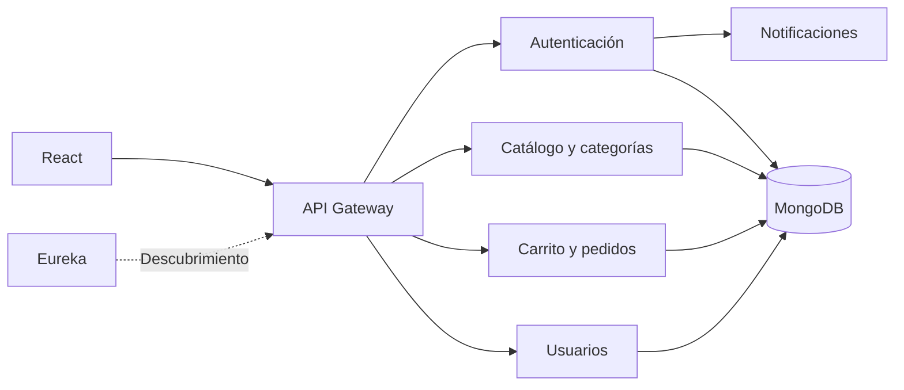

# ECOVIDA — E-commerce con microservicios

Adaptación individual de **Sebastian Monga** de una plataforma de comercio electrónico,
con React, Spring Boot, MongoDB, Eureka y API Gateway.

## Qué contiene

- Registro e inicio de sesión con JWT.
- Catálogo de productos y categorías.
- Carrito y gestión de pedidos.
- Notificaciones por correo.
- Pantallas de administración.
- Configuración de ejecución mediante Docker Compose.

Este es el **repositorio principal de ECOVIDA** en este perfil. Los repositorios separados
de servicios y frontend se conservan como referencias del desarrollo.

## Arquitectura

## Organización

| Ruta | Contenido |
|---|---|
| `frontend/` | Aplicación React y configuración Nginx |
| `microservice-backend/` | Servicios Java, gateway y registro Eureka |
| `docker-compose.yml` | Definición del conjunto de contenedores |
| `sample data/` | Datos de catálogo de ejemplo |
| [Documentación de la versión inicial](docs/VERSION_INICIAL.md) | Detalle histórico de endpoints, configuración y capturas |

## Mi participación y origen

Trabajé individualmente en la adaptación de la base de referencia para ECOVIDA.
Esta versión incorpora la integración mediante Docker Compose y Dockerfiles.
La arquitectura y el código de referencia mantienen su autoría original.

Base identificada: [Fullstack-E-commerce-web-application](https://github.com/DharshiBalasubramaniyam/Fullstack-E-commerce-web-application),
de **Dharshi Balasubramaniyam**, distribuida bajo [Apache License 2.0](LICENSE).
Se conserva el crédito en [NOTICE](NOTICE).

## Estado y ejecución

El código publicado corresponde a la versión académica histórica. La copia de
preparación del portafolio, revisada y compilada localmente, aún no se ha incorporado aquí.
Por ello no se atribuyen a este snapshot las correcciones o pruebas de esa copia.

El arranque requiere JDK 21, Node.js/npm, MongoDB y configuración de servicios,
JWT y correo. Revisar la documentación histórica y usar configuración privada propia.
El flujo completo de compra y un despliegue público actual no están certificados.

## Otros repositorios de este proyecto

[Autenticación](https://github.com/sebas-09/auth-service) ·
[Gateway](https://github.com/sebas-09/api-gateway) ·
[Productos](https://github.com/sebas-09/product-service) ·
[Categorías](https://github.com/sebas-09/category-service) ·
[Carrito](https://github.com/sebas-09/cart-service) ·
[Pedidos](https://github.com/sebas-09/order-service) ·
[Usuarios](https://github.com/sebas-09/user-service) ·
[Notificaciones](https://github.com/sebas-09/notification-service) ·
[Eureka](https://github.com/sebas-09/service-registry) ·
[Frontend](https://github.com/sebas-09/frontend)
